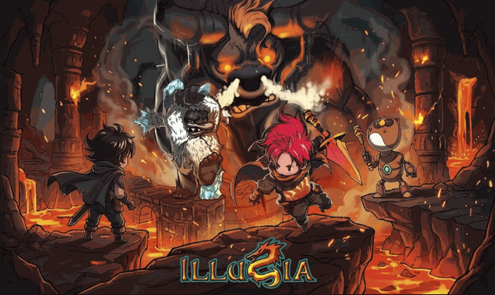

# ILLUSIA Vita

<p align="center">
  
</p>

<p align="center">
  Native port of <b>ILLUSIA</b> (Android, <code>com.gamevil.illusia</code>, Gamevil <b>Nexus2</b> engine)
  to the PS Vita. Runs the original <code>libgameDSO.so</code> unmodified through a
  <a href="lib/so_util">SoLoader</a> + <a href="lib/falso_jni">FalsoJNI</a> bridge — no game logic was
  reimplemented, only the Android/JNI/OpenGL ES layer underneath it.
</p>

<p align="center">
  
  
  
</p>

## Status

- ✅ Playable start to finish on real hardware (Vita/PSTV): story, combat, and menus all work.
- ✅ Native sound (custom WAV mixer, see `source/utils/audio.c`), 30 FPS cap (matching the original
  engine's intended pacing), physical + touch controls, persistent saves
  (`ux0:data/illusia/saves/`), full LiveArea.
- 🔧 **12 confirmed and resolved bugs**, each documented with its real root cause (no speculative
  patches) in [`port_progress.md`](port_progress.md).
- 📋 Full porting plan and engine findings in [`PORTING_PLAN.md`](PORTING_PLAN.md).

## Requirements

- A PS Vita or PSTV on Henkaku/Ensō (or h-encore²/rejuvenate on recent firmware).
- `kubridge` installed (`kubridge.skprx`) — explicitly checked at boot, see `source/utils/init.c`.
- `libshacccg.suprx` installed (standard requirement for any homebrew using `vitaGL`/`SceShaccCg` to
  compile Cg shaders at runtime).
- A legitimate copy of the original ILLUSIA APK (`illusia-102.apk`). This repository does **not**
  include or distribute the APK or the game's assets (see `.gitignore`) — only the port's code.

## Installation

1. Install the generated `.vpk` (`build/illusia.vpk`) with VitaShell.
2. Extract the `assets/` folder from the original APK and copy it to `ux0:data/illusia/assets/`.
3. Launch the game. The first run automatically creates `ux0:data/illusia/saves/` for save data.

## Controls

On Android, ILLUSIA is a fully touch-driven game (its D-pad and action buttons are on-screen
overlays). This port keeps that touch input working as-is, and additionally maps the Vita's
physical buttons to the legacy keypad codes the engine already understood internally
(`source/main.c`):

| Vita | Action |
|---|---|
| ⬆️ / ⬇️ / ⬅️ / ➡️ (D-pad or left stick) | Movement / menu navigation |
| ✕ (Cross) | Confirm / primary action |
| ○ (Circle) | Secondary action |
| □ (Square) | Contextual action (roughly "Clear"/attack, depending on the screen) |
| △ (Triangle) | Contextual softkey / menu |
| START | Pause / menu |
| **SELECT** | **Skip scripted cutscene** (the only key the engine listens for to call `DoSkip()` on scripted cutscenes — confirmed via `CGsInputKey::GxKey2GsKey`, see `port_progress.md`) |
| Front touch screen | On-screen D-pad and virtual buttons (identical to the original Android UI) — multitouch supported |

> The left analog stick also acts as a D-pad (fixed threshold in `source/main.c`).
> Since the original engine was designed touch-first, some menu screens may respond better to a tap
> than to the equivalent physical button — if something doesn't advance, try touching the screen.

## Building from source

Requires [VitaSDK](https://vitasdk.org/) installed and on your `PATH`.

```sh
export VITASDK=/path/to/vitasdk
export PATH="$VITASDK/bin:$PATH"

mkdir -p build && cd build
cmake .. -DCMAKE_BUILD_TYPE=Release
make -j$(nproc)
```

It can also be built/deployed with `psvita-port-toolkit` (see below):

```sh
psvita-toolkit build --preset release
psvita-toolkit deploy --vpk
```

## Repository layout

- `source/`, `lib/so_util`, `lib/falso_jni` — the loader (SoLoader + FalsoJNI) and its compatibility
  patches (`patch.c`, `java.c`, `dynlib.c`).
- `decompiled/` — decompiled Java (jadx) and pseudo-C (Ghidra) of the original `.so`, used for crash
  triage (gitignored, regenerable).
- `PORTING_PLAN.md` — living porting plan, updated as real engine details get confirmed.
- `port_progress.md` — bug log, one confirmed bug at a time, each with its real root cause and fix.
- `.psvita-toolkit.json` — configuration for `psvita-port-toolkit`, the standalone tool that manages
  this port's build/deploy/logs/LiveArea/crash dumps.

This port does not keep a local copy of `porting_tools/` — all build/deploy/debug work goes through
**psvita-port-toolkit**, outside this repository.

## Development workflow

1. Analyze the `.so`'s symbols before touching the loader (engine: Gamevil Nexus2, GLES1.1
   fixed-pipeline, standard JNI without `RegisterNatives`).
2. Bootstrap the loader (SoLoader + FalsoJNI + Bionic↔VitaSDK ARM compatibility patches).
3. Build/deploy via `psvita-port-toolkit` → Vita3K → real hardware.
4. One confirmed bug at a time, cross-referencing a real log + `.psp2dmp` + Ghidra pseudo-C +
   decompiled Java source — never a speculative patch without evidence.
5. Every confirmed bug gets documented in `port_progress.md` with its root cause.

## ☕ Support My Work

This project is **free** and will stay free. If you enjoy it, a tip from **$1** helps me keep porting games to the PS Vita:

<p align="center">
  <a href="https://ko-fi.com/metalsyntax"></a>
</p>

- **Ko-fi:** [ko-fi.com/metalsyntax](https://ko-fi.com/metalsyntax)
- **PayPal:** [paypal.me/MetalSyntax](https://paypal.me/MetalSyntax)
- **Bitcoin (BTC):** `133HdCsaWxdjTfmwpgGVykByhNBV338uRc`

**Ko-fi supporters get:**
- **Early access** to new ports before their public release (test builds of upcoming projects).
- **Data preparation scripts and step-by-step guides** to set up your own game files for each new port.
- A say in which games I port next.

> Game files are never distributed. You always need your own legally obtained copy of the game.

---

## Credits

- **ILLUSIA** and its engine (Gamevil Nexus2) are property of **Gamevil Inc.** — this repository
  makes no claim of authorship over the original game.
- SoLoader/FalsoJNI boilerplate based on the work of Andy Nguyen, Rinnegatamante, and
  Volodymyr Atamanenko (see [`LICENSE`](LICENSE)).

## License

This port's code is MIT-licensed (see [`LICENSE`](LICENSE)). The game and all of its assets
(graphics, audio, text, `libgameDSO.so`) remain the property of **Gamevil Inc.** and are **not**
distributed in this repository — you need your own legitimate copy of the APK to use this port.
