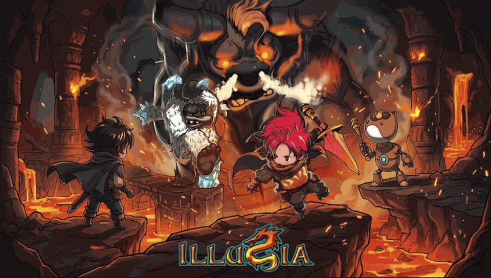

<h1 align="center">
  <br>
  ILLUSIA · PS Vita Port
</h1>

<p align="center">
  <b>Native port of ILLUSIA (Gamevil) for PlayStation Vita and PlayStation TV.</b>
</p>

<p align="center">
  
  
  
  
  
  
</p>

<p align="center">
  <a href="#-description">Description</a> •
  <a href="#-features">Features</a> •
  <a href="#-controls">Controls</a> •
  <a href="#-installation">Installation</a> •
  <a href="#-known-issues">Known Issues</a> •
  <a href="#-building-from-source">Build</a> •
  <a href="#-credits">Credits</a>
</p>

---

## 📖 Description

Native port of **ILLUSIA** (Android, `com.gamevil.illusia`, Gamevil **Nexus2** engine) to the PS Vita. It runs the
original `libgameDSO.so` **unmodified** through a [SoLoader](lib/so_util) + [FalsoJNI](lib/falso_jni) bridge.
No game logic was reimplemented: only the Android / JNI / OpenGL ES layer underneath it.

The original executable is ARMv6 and uses OpenGL ES 1.1 fixed-function rendering, which is mapped onto **vitaGL**.
Audio is rebuilt on SDL2 (`SDL_OpenAudioDevice`) with a from-scratch IMA4/CAF decoder.

---

## 🎮 Status & Playability

**Status: Playable (v1.0.1, out of Beta)**

- ✅ Playable start to finish on real hardware (Vita/PSTV): story, combat, and menus all work.
- ✅ Native sound, 30 FPS cap (matching the original engine's intended pacing), physical + touch controls, persistent
  saves (`ux0:data/illusia/saves/`), full LiveArea.
- 🔧 **12 confirmed and resolved bugs**, each documented with its real root cause (no speculative patches) in
  [`port_progress.md`](port_progress.md).
- 📋 Full porting plan and engine findings in [`PORTING_PLAN.md`](PORTING_PLAN.md).
- 📝 Release notes for v1.0.1 (audio engine rewrite and I/O performance fixes) in [`RELEASE_NOTES.md`](RELEASE_NOTES.md).

---

## ✨ Features

| Feature | Status | Notes |
| :--- | :---: | :--- |
| Boots to gameplay | ✅ | Playable start to finish on real hardware (Vita/PSTV). |
| Graphics / renderer | ✅ | OpenGL ES 1.1 fixed-function rendering on vitaGL. |
| Audio & music | ✅ | Real BGM and sound effects, rebuilt on SDL2 in v1.0.1 (volume scale and music routing fixed). |
| Video / cutscenes | ✅ | Scripted cutscenes run in-engine; SELECT skips them. |
| Physical buttons | ✅ | Cross, Circle, Square, Triangle, START and SELECT mapped to the engine's key codes. |
| Analog sticks / camera | ✅ | Left stick acts as a D-pad (fixed threshold in `source/main.c`). |
| Touch screen | ✅ | The original on-screen D-pad and buttons work, multitouch supported. |
| Button remapping / port menu | ✅ | START + SELECT options menu: remap buttons, text language, accents. |
| Save data | ✅ | Persistent saves in `ux0:data/illusia/saves/`. |
| Native trophies | ➖ | Not implemented. |
| Languages | 🧪 | English, Spanish and Portuguese text packs (see [Text language](#text-language)). Not documented as tested on console. |
| Performance | 🧪 | Capped at 30 FPS. <!-- TODO: no measured numbers in the repo --> |
| Online / IAP / ads | ➖ | ❔ <!-- TODO: not documented in the repo --> |
| PS TV | 🧪 | Status says "real hardware (Vita/PSTV)". <!-- TODO: confirm the PS TV test --> |

Legend: `✅ Working (verified on console) · 🧪 Implemented, not yet verified on console · 🟡 Partial · ❌ Not working · ➖ Not applicable · ❔ Not documented yet`

---

## 🎯 Controls

On Android, ILLUSIA is a fully touch-driven game (its D-pad and action buttons are on-screen overlays). This port
keeps that touch input working as-is, and additionally maps the Vita's physical buttons to the legacy keypad codes
the engine already understood internally (`source/main.c`):

| Vita | Action |
| :--- | :--- |
| ⬆️ / ⬇️ / ⬅️ / ➡️ (D-pad or left stick) | Movement / menu navigation |
| ✕ (Cross) | Confirm / primary action |
| ○ (Circle) | Secondary action |
| □ (Square) | Contextual action (roughly "Clear"/attack, depending on the screen) |
| △ (Triangle) | Contextual softkey / menu |
| START | Pause / menu |
| **SELECT** | **Skip scripted cutscene** (the only key the engine listens for to call `DoSkip()` on scripted cutscenes; confirmed via `CGsInputKey::GxKey2GsKey`, see `port_progress.md`) |
| Front touch screen | On-screen D-pad and virtual buttons (identical to the original Android UI), multitouch supported |
| **START + SELECT** | **PS Vita options menu** (game pauses): button remapping and text language |

> The left analog stick also acts as a D-pad (fixed threshold in `source/main.c`).
> Since the original engine was designed touch-first, some menu screens may respond better to a tap than to the
> equivalent physical button. If something doesn't advance, try touching the screen.

### Options menu (START + SELECT)

Every action in the table above can be rebound (✕ replace, □ add a second button, △ unbind, ○ save & close; L/R are
free to use). Bindings are saved in `ux0:data/illusia/controls.txt` (hand-editable, `ACTION = BTN, BTN`).

### Text language

The options menu has a **Text language** row (ENGLISH / ESPANOL / PORTUGUES) that switches menus, items, skills,
quests, popups, help **and the story dialogue** without restarting (a window that is already open refreshes the next
time it opens). It needs the translation pack `illusia_vita_traduccion_ES_PT.zip` extracted to the root of `ux0:`; it
adds `ux0:data/illusia/assets/data/{spa,por,spa_ascii,por_ascii}/`,
`ux0:data/illusia/assets/script/{spa,por,spa_ascii,por_ascii}/output.dlg` and
`ux0:data/illusia/assets/font/illusia_latin1.ft2`. The English files are never modified, and anything missing falls back
to English. Monster and map names (and the names of people) stay in English.

**Accents** (á é í ó ú ñ ü ç ã õ â ê ô à ¿ ¡): the game's bitmap font is ASCII + Korean only, but its engine has an unused
ISO-8859-1 mode. The port attaches an extra font built from the game's own 5x11 letters plus accent marks, so accented
text keeps the original look. The **Accents** row of the options menu (`ACCENTS = 1|0` in `controls.txt`) switches to the
accent-free copy of the pack, which is also used automatically if the font file is missing.

Packs are built from the templates in `illusia_translation/` with `python3 scripts/illusia_lang.py build es|pt`.

---

## ⚙️ Options

Settings live in `ux0:data/illusia/controls.txt`, which the options menu writes. The file can also be edited by hand:

| Key | Values | Meaning |
| :--- | :--- | :--- |
| `ACTION = BTN, BTN` | Vita button names | Button bindings for each on-screen action (`✕` replace, `□` add, `△` unbind in the menu). |
| `ACCENTS` | `1` / `0` | `1` uses the accented text pack (Latin-1 font); `0` uses the accent-free copy. Default: <!-- TODO: confirm -->. |

---

## 📋 Prerequisites

- A PS Vita or PS TV on Henkaku / Enso (or h-encore² / rejuvenate on recent firmware).
- `kubridge` installed (`kubridge.skprx`). It is explicitly checked at boot (see `source/utils/init.c`).
- `libshacccg.suprx` installed. This is the standard requirement for any homebrew using `vitaGL` / `SceShaccCg` to compile
  Cg shaders at runtime.
- A legitimate copy of the original ILLUSIA APK (`illusia-102.apk`). This repository does **not** include or distribute
  the APK or the game's assets (see `.gitignore`), only the port's code.

---

## 📦 Installation

1. Install the generated `.vpk` (`build/illusia.vpk`) with VitaShell.
2. Extract the `assets/` folder from the original APK and copy it to `ux0:data/illusia/assets/`.
3. *(Optional)* For the Spanish or Portuguese text, extract `illusia_vita_traduccion_ES_PT.zip` to the root of `ux0:`.
4. Launch the game. The first run automatically creates `ux0:data/illusia/saves/` for save data.

### Final File Structure in `ux0:data/illusia/`

```text
ux0:data/illusia/
├── assets/          <- The APK's assets/ folder (required)
├── saves/           <- Created automatically on the first run (save data)
└── controls.txt     <- Written by the options menu (button bindings, ACCENTS)
```

The translation pack adds folders under `assets/` (`data/spa`, `data/por`, `script/…/output.dlg`, `font/illusia_latin1.ft2`);
see [Text language](#text-language).

---

## 🐛 Known Issues

- **Touch-first menus**: some screens respond better to a tap than to the matching physical button. Touch the screen
  if something does not advance.
- **Untranslated text in ES/PT**: monster and map names, names of people, text inside `.pzx` / `.gui` images, the Korean
  legal notices in `StrHelp`, and the name-entry screen are left in their original form on purpose.
- **Accent glyphs**: no routine outside `CGxBFont` handles bytes ≥ 0x80 when drawing or splitting text. If a strange glyph
  appears on the console, set `ACCENTS = 0` to avoid it.
- **Crash dumps** are written by the system to `ux0:data/` (not to the game folder). See `port_progress.md` for how
  each confirmed bug was diagnosed.

---

## 🔨 Building from Source

Requires [VitaSDK](https://vitasdk.org/) installed and on your `PATH`.

```sh
export VITASDK=/path/to/vitasdk
export PATH="$VITASDK/bin:$PATH"

mkdir -p build && cd build
cmake .. -DCMAKE_BUILD_TYPE=Release
make -j$(nproc)
```

It can also be built and deployed with `psvita-port-toolkit` (see below):

```sh
psvita-toolkit build --preset release
psvita-toolkit deploy --vpk
```

### Development workflow

1. Analyze the `.so`'s symbols before touching the loader (engine: Gamevil Nexus2, GLES1.1 fixed-pipeline, standard JNI
   without `RegisterNatives`).
2. Bootstrap the loader (SoLoader + FalsoJNI + Bionic ↔ VitaSDK ARM compatibility patches).
3. Build/deploy via `psvita-port-toolkit` → Vita3K → real hardware.
4. One confirmed bug at a time, cross-referencing a real log + `.psp2dmp` + Ghidra pseudo-C + decompiled Java source.
   Never a speculative patch without evidence.
5. Every confirmed bug gets documented in `port_progress.md` with its root cause.

---

## 📁 Project Structure

- `source/`, `lib/so_util`, `lib/falso_jni`: the loader (SoLoader + FalsoJNI) and its compatibility patches
  (`patch.c`, `java.c`, `dynlib.c`).
- `source/utils/`: audio (`audio.c`), boot checks (`init.c`) and helpers.
- `illusia_translation/`: templates for the ES / PT text packs; `scripts/illusia_lang.py` builds them.
- `decompiled/`: decompiled Java (jadx) and pseudo-C (Ghidra) of the original `.so`, used for crash triage
  (git-ignored, regenerable).
- `PORTING_PLAN.md`: living porting plan, updated as real engine details get confirmed.
- `port_progress.md`: bug log, one confirmed bug at a time, each with its real root cause and fix.
- `RELEASE_NOTES.md`: release notes.
- `HOWTO_FIX_COMMON_PORT_BUGS.md`: notes on recurring porting bugs.
- `.psvita-toolkit.json`: configuration for `psvita-port-toolkit`, the standalone tool that manages this port's
  build, deploy, logs, LiveArea and crash dumps.

This port does not keep a local copy of `porting_tools/`. All build, deploy and debug work goes through
**psvita-port-toolkit**, outside this repository.

---

## 📜 Disclaimer

**ILLUSIA** and its engine (Gamevil Nexus2) are property of **Gamevil Inc.** This repository makes no claim of authorship
over the original game. It does NOT contain original game code, binaries, copyrighted graphics, or game assets. The
authors do not promote or condone piracy in any way. To play, you must provide your own legitimate copy of the APK.

---

## ☕ Support My Work

This project is **free** and will stay free. If you enjoy it, a tip from **$1** helps me keep porting games to the PS Vita:

<p align="center">
  <a href="https://ko-fi.com/metalsyntax"></a>
</p>

- **Ko-fi:** [ko-fi.com/metalsyntax](https://ko-fi.com/metalsyntax)
- **PayPal:** [paypal.me/MetalSyntax](https://paypal.me/MetalSyntax)
- **Bitcoin (BTC):** `133HdCsaWxdjTfmwpgGVykByhNBV338uRc`

**Ko-fi supporters get:**
- **Early access** to new ports before their public release (test builds of upcoming projects).
- **Data preparation scripts and step-by-step guides** to set up your own game files for each new port.
- A say in which games I port next.

> Game files are never distributed. You always need your own legally obtained copy of the game.

---

## 👥 Credits

- **ILLUSIA** and its engine (Gamevil Nexus2) are property of **Gamevil Inc.**
- SoLoader / FalsoJNI boilerplate based on the work of Andy Nguyen, Rinnegatamante, and Volodymyr Atamanenko
  (see [`LICENSE`](LICENSE)).
- Special thanks to the PS Vita homebrew and porting community.

---

## 📄 License

This port's code is MIT-licensed (Copyright (C) 2021 Andy Nguyen), see [`LICENSE`](LICENSE). The game and all of its
assets (graphics, audio, text, `libgameDSO.so`) remain the property of **Gamevil Inc.** and are **not** distributed in
this repository. You need your own legitimate copy of the APK to use this port.
